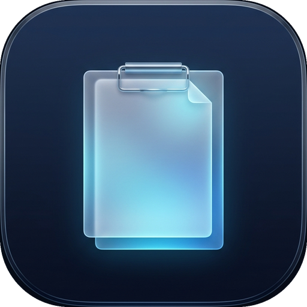
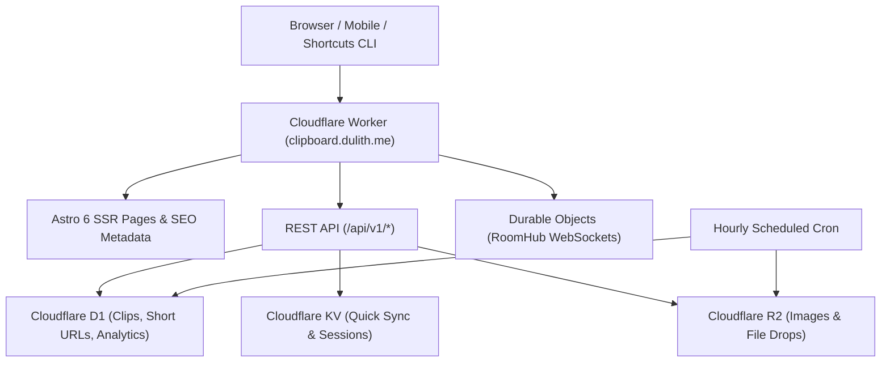

<p align="center">
  
</p>

<h1 align="center">Online Clipboard</h1>

<p align="center">
  Cross-device clipboard for text, code, files, live sync, scribble, and short links.
</p>

<p align="center">
  <a href="https://astro.build/"></a>
  <a href="https://workers.cloudflare.com/"></a>
  <a href="https://react.dev/"></a>
  <a href="LICENSE"></a>
</p>

<p align="center">
  <a href="#overview">Overview</a> &bull;
  <a href="#architecture">Architecture</a> &bull;
  <a href="#credits-and-enhancements">Credits</a> &bull;
  <a href="#project-structure">Structure</a> &bull;
  <a href="#installation">Installation</a> &bull;
  <a href="#usage">Usage</a> &bull;
  <a href="#verification-tests">Testing</a> &bull;
  <a href="#security-and-privacy">Security</a> &bull;
  <a href="#license">License</a>
</p>

## Overview

Online Clipboard is a cross-device transfer workspace for sharing text, Markdown, syntax-highlighted code, images, files, and short links across desktop and mobile browsers.

It includes optional client-side end-to-end encryption, password protection, burn-after-read view limits, real-time collaborative rooms, and a headless API for Apple Shortcuts, Android HTTP Shortcuts, and terminal workflows.

## Architecture

| Route | Capability | Persistence & Transport | Privacy Controls |
| :--- | :--- | :--- | :--- |
| `/` | Text, Markdown, Code, Image Clipboard | Cloudflare D1 + R2 | Optional AES-256-GCM E2EE, PBKDF2 Password, TTL, Burn-After-Read |
| `/live-clipboard` | Real-Time Text & Image Room | Durable Objects WebSockets | Ephemeral room ID, `noindex` on room sessions |
| `/scribble` | Collaborative Drawing Canvas | Durable Objects WebSockets | Multi-user stroke history, PNG export |
| `/file-drop` | Multi-File Transfer (up to 98 MB) | Cloudflare R2 + Durable Objects | Download count limit, TTL expiry, Password |
| `/url` & `/u/[code]` | URL Shortener & Click Telemetry | Cloudflare D1 | Browser, OS, device, country breakdown (`+` suffix) |
| `/shortcuts` | Headless CLI & Mobile Shortcuts API | Cloudflare KV (`/api/v1/quick`) | Bearer token & `X-Client-Name` header |
| `/vault` | Device History & Owner Storage Vault | `localStorage` + Signed HMAC Cookie | Passcode-locked storage monitor & upload toggles |



## Credits and Enhancements

Forked from `SarathAdhi/Online-Clipboard`, integrating and upgrading ideas from four open-source clipboard projects:

| Repository | Adapted Features | Enhancements |
| :--- | :--- | :--- |
| [SarathAdhi/Online-Clipboard](https://github.com/SarathAdhi/Online-Clipboard) | Clip IDs, `-e` edits, Live Sync, Scribble, File Drop, URL `+` stats | Rebuilt on Cloudflare Workers/D1/R2/DO, PBKDF2 auth, XSS fixes, Liquid Glass UI |
| [ling-drag0n/CloudPaste-old](https://github.com/ling-drag0n/CloudPaste-old) | TTL expiry, burn limits, Markdown, QR, upload progress, export | Modular Astro routes, PBKDF2 passwords, AES-256-GCM E2EE, `320px` responsive UI |
| [YanxinTang/clipboard-online](https://github.com/YanxinTang/clipboard-online) | Headless `GET`/`POST` sync API and `X-Client-Name` tracking | Global `/api/v1/quick` edge endpoint with Bearer auth and `/shortcuts` guide |
| [a-robert/online-clipboard](https://github.com/a-robert/online-clipboard) | Separate authenticated personal vault (`/vault`) | Server-side HMAC-SHA256 HTTP-only cookie auth via Worker secrets |

## Project Structure

```
.
├── assets/
│   └── logo.png                  # High-resolution transparent PNG brand mark
├── public/
│   ├── og-image.png              # 1200x630 Open Graph preview image
│   ├── manifest.json             # PWA web app manifest
│   ├── robots.txt                # Search crawler directives
│   └── favicon.* / icon-*.png    # Multi-size favicons and Apple touch icon
├── src/
│   ├── components/               # Interactive React islands and Liquid Glass controls
│   ├── layouts/PageLayout.astro  # Zero-FOUC theme shell, SEO meta, JSON-LD, optical SVG defs
│   ├── lib/                      # PBKDF2 crypto, AES-GCM E2EE, sanitize, TTL, UA parser
│   ├── pages/                    # Dedicated SSR pages and /api/v1/* endpoints
│   ├── styles/liquid-glass.css   # Tri-state semantic tokens and Liquid Glass primitives
│   └── worker/                   # Custom Worker entrypoint, Durable Objects RoomHub, D1 schema, cron
├── tests/                        # Vitest unit tests
├── astro.config.mjs              # Astro + Cloudflare adapter + Sitemap config
└── wrangler.jsonc                # Cloudflare Workers, D1, KV, R2, Durable Objects bindings
```

## Installation

### Prerequisites

- Node.js `>= 22.12.0`
- Cloudflare account with Workers, D1, KV, and R2 enabled (`wrangler` CLI)

### Setup Steps

1. Clone the repository:

```bash
git clone https://github.com/dulithdivisekara/online-clipboard.git
cd online-clipboard
```

2. Install dependencies:

```bash
npm install --legacy-peer-deps
```

3. Configure local development secrets (never commit `.dev.vars`):

```bash
cp .dev.vars.example .dev.vars
```

4. Provision and initialize D1 schema locally:

```bash
npx wrangler d1 execute clipboard-db --local --yes --file=src/worker/schema.sql
```

## Usage

### Local Development

```bash
npm run dev
```

### Cloudflare Production Deployment

1. Create your D1 database, KV namespace, and R2 bucket in Cloudflare and update their IDs and custom `routes` in `wrangler.jsonc`.
2. Apply remote D1 schema and set production secrets:

```bash
npx wrangler d1 execute clipboard-db --remote --yes --file=src/worker/schema.sql
npx wrangler secret put VAULT_PASSCODE
npx wrangler secret put SESSION_SECRET
npx wrangler secret put QUICK_API_TOKEN
```

3. Build and deploy:

```bash
npm run deploy
```

### Headless Shortcuts & CLI Example

```bash
# Save a 1-day text clip publicly
curl -X POST https://clipboard.dulith.me/api/v1/clips \
  -H "Content-Type: application/json" \
  -d '{"content":"Hello from terminal","expiresIn":"1d"}'

# Push to personal quick-sync buffer (requires QUICK_API_TOKEN)
pbpaste | curl -X POST \
  -H "Authorization: Bearer YOUR_TOKEN" \
  -H "X-Client-Name: MacBook" \
  --data-binary @- \
  https://clipboard.dulith.me/api/v1/quick
```

## Verification Tests

Run the automated unit tests and full Astro/TypeScript production build:

```bash
npm test
npm run build
```

## Session Logging and Inspection

Cloudflare Workers stream stdout/stderr diagnostics at the edge rather than writing persistent local log files. Inspect live HTTP requests, WebSocket room activity, and hourly cron executions with:

```bash
npx wrangler tail
```

## Security and Privacy

- Local secret files (`.dev.vars`, `.dev.vars.*`, `.env`, `.env.*`, `*.pem`, `*.key`) and log files (`*.log`) are excluded via `.gitignore`; production credentials (`VAULT_PASSCODE`, `SESSION_SECRET`, `QUICK_API_TOKEN`) are stored as Cloudflare Worker secrets.
- Clip passwords use salted PBKDF2-SHA256 (100,000 iterations) and are never exposed in client responses.
- Browser-side Zero-Knowledge E2EE uses AES-256-GCM with the key retained strictly in the URL `#fragment`.
- See [SECURITY.md](SECURITY.md) for vulnerability reporting instructions.

## License

This project is licensed under the [MIT License](LICENSE).
